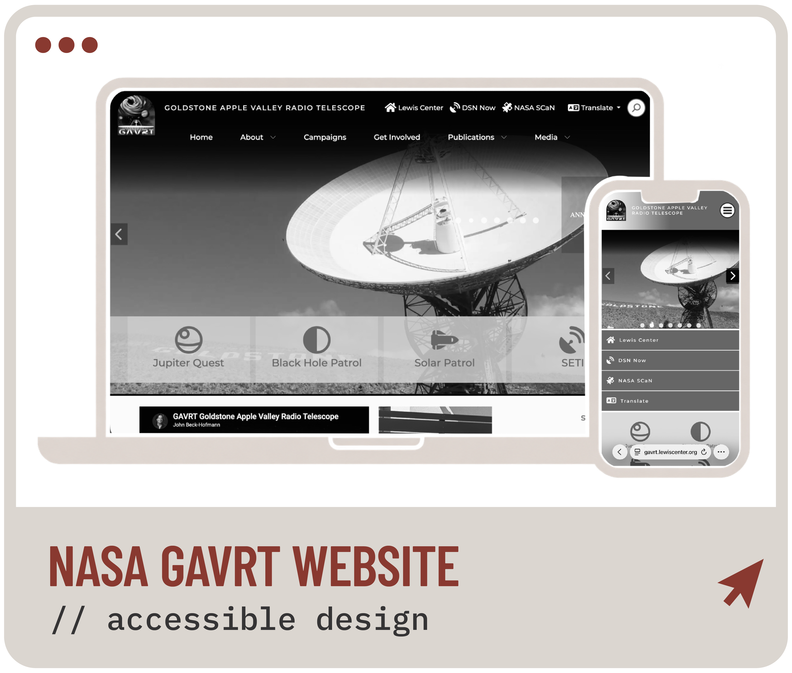
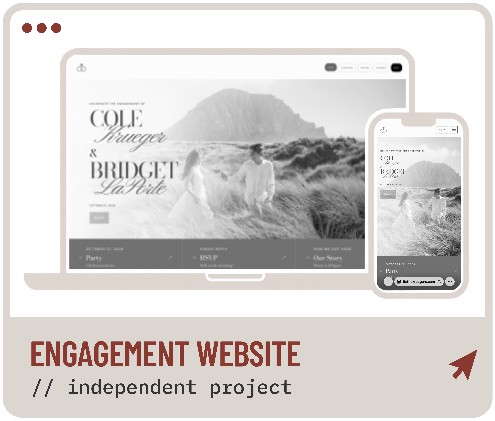
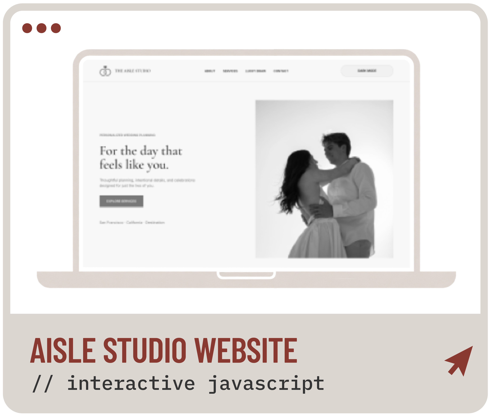
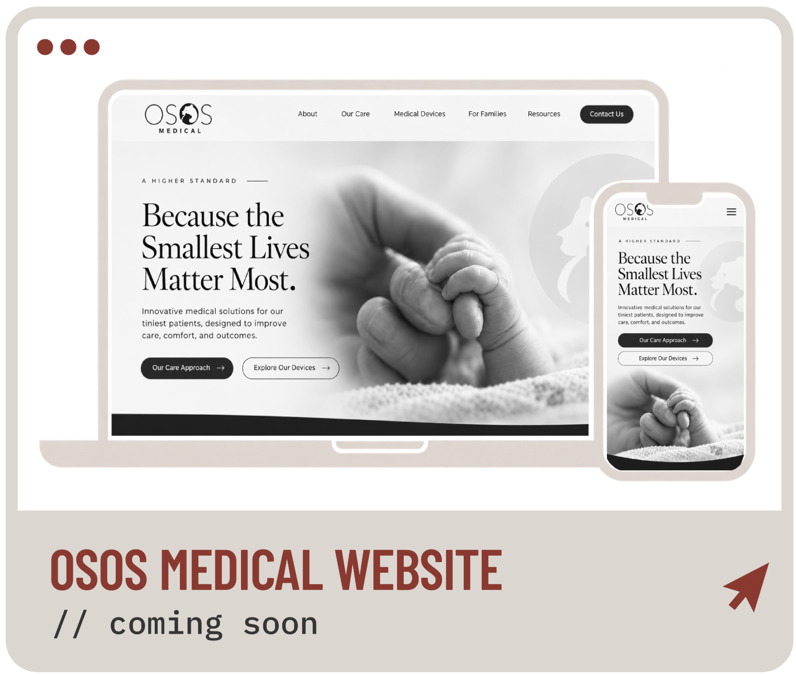

<picture>
  <source media="(prefers-color-scheme: dark)" srcset="assets/header-dark.png">
  <source media="(prefers-color-scheme: light)" srcset="assets/header-light.png">
  
</picture>

**Accessible, user-centered websites that bring design, development, and communication together.**

[LinkedIn](https://www.linkedin.com/in/bridgetlaporte) · [Technical skills](#technical-skills)

## About Me

I'm studying Graphic Information Technology — Full-Stack Development at **Arizona State University Ira A. Fulton Schools of Engineering**. I also graduated **valedictorian at California Polytechnic State University, San Luis Obispo**, with my B.A. in Communication Studies for Media & Technology.

My experience includes digital communications and website design and accessibility work from my internship at **NASA Glenn Research Center** for the JPL and GAVRT programs. I'm interested in building digital experiences that are intuitive, accessible, and thoughtfully designed. I am currently working as Head Of Brand & Digital for **Osos Medical** where I am currently developing their brand, marketing, and website.  

## Featured Work

<table>
  <tr>
    <td width="50%" valign="top">
      
      
<strong>NASA GAVRT Website</strong> Scientific communication, content organization, and accessibility.

      
<a href="case-studies/nasa-gavrt.md">Case Study</a> · <a href="https://gavrt.lewiscenter.org/">Public GAVRT Website</a>

    </td>
    <td width="50%" valign="top">
      
      
<strong>The Kruegers Engagement Website</strong> Independent responsive web development with galleries and RSVP functionality.

      
<a href="case-studies/engagement-website.md">Case Study</a> · <a href="https://itsthekruegers.com/">Live Website</a> · <a href="https://github.com/laportebridget/itsthekruegers">Repository</a>

    </td>
  </tr>
  <tr>
    <td width="50%" valign="top">
      
      
<strong>The Aisle Studio</strong> Interactive JavaScript and front-end development.

      
<a href="case-studies/aisle-studio.md">Case Study</a> · <a href="https://www.behance.net/gallery/256856183/The-Aisle-Studio">Behance Project</a> · <a href="https://github.com/bridgetlaporte/aisle-studio">Repository</a>

    </td>
    <td width="50%" valign="top">
      
      
<strong>Osos Medical</strong> Brand & Digital — <em>coming soon</em>.

      
<em>Concept Preview; website not yet published.</em>

    </td>
  </tr>
</table>

## Technical Skills

| Area | Skills & tools |
| --- | --- |
| **Front-end** | HTML5, CSS3, JavaScript, semantic markup, responsive design, DOM interactions, forms, accessibility |
| **Back-end & APIs** | SQL, Python, server side JavaScript, HTTP requests, JSON, API integration |
| **Databases** | MySQL, Microsoft SQL Server, relational database design, SQL queries and joins |
| **Development & Design** | VS Code, GitHub Desktop, GitHub, Figma, Adobe Illustrator, Adobe Photoshop, Adobe InDesign, MySQL Workbench, Azure Data Studio, Docker |

<strong>Experience & Education</strong>

### Experience

- **NASA Glenn Research Center:** Digital communications internship focusing on translating scientific research content, web accessibility and development, and science communication.
- **Osos Medical:** Brand and digital development work in progress. Initial stages of web application development, website not yet launched.

### Education

- **Arizona State University Ira A. Fulton Schools of Engineering:** Graphic Information Technology, Full-Stack Development.
- **California Polytechnic State University, San Luis Obispo:** Valedictorian - B.A., Communication Studies for Media & Technology, 2025.

<strong>My Development Process</strong>

I start by understanding the audience and organizing content. I use wireframes and Figma to develop layouts, then build with semantic HTML, CSS, and JavaScript. I test responsiveness, accessibility, and functionality before refining the finished experience. My workflow includes VS Code for editing and GitHub Desktop for version control. For data-backed projects, I also work with SQL, APIs, and server-side tools. 

## Currently Building

**The Kruegers Wedding Website — GIT 480 Senior Project:** A website in progress, built from Figma designs, with responsive layouts, navigation, and planned guest-facing functionality.

I'm continuing to expand my experience with JavaScript, databases, APIs, and ull-stack application development. I am passionate about what I do, and thats why I do it. See why we click... visit my LinkedIn and Website!

## Connect

[LinkedIn](https://www.linkedin.com/in/bridgetlaporte) · [GitHub](https://github.com/laportebridget)
