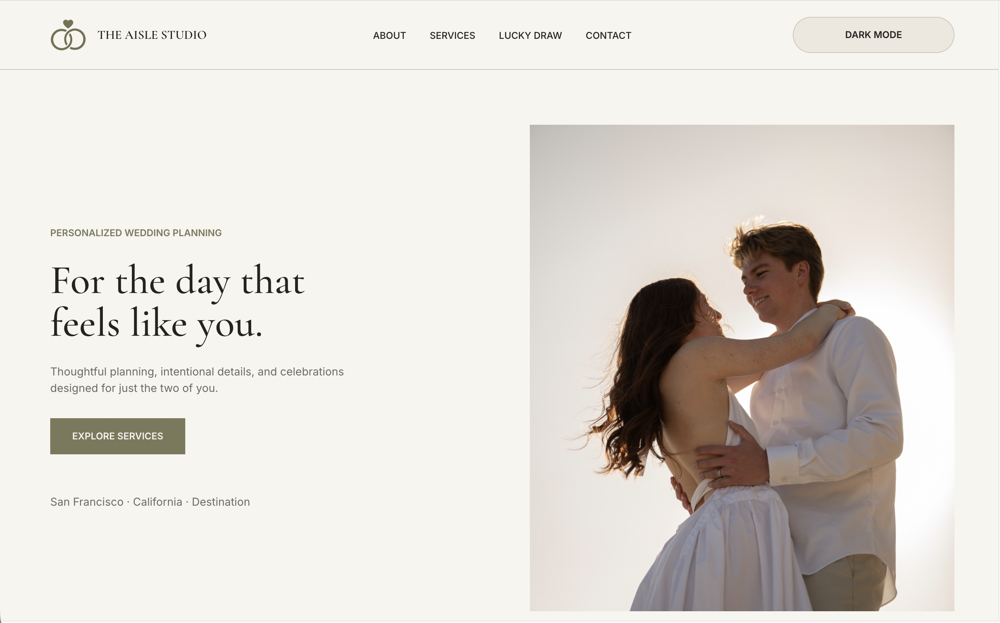
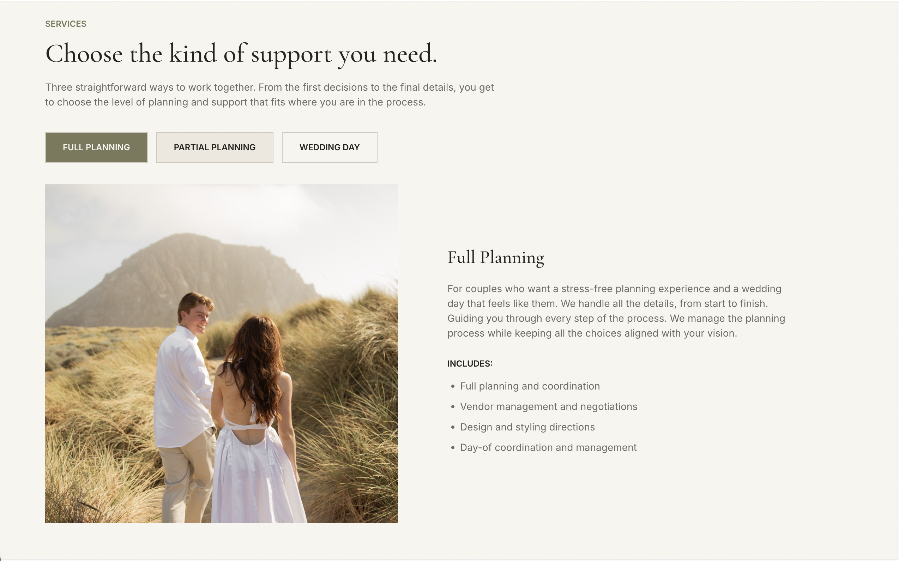
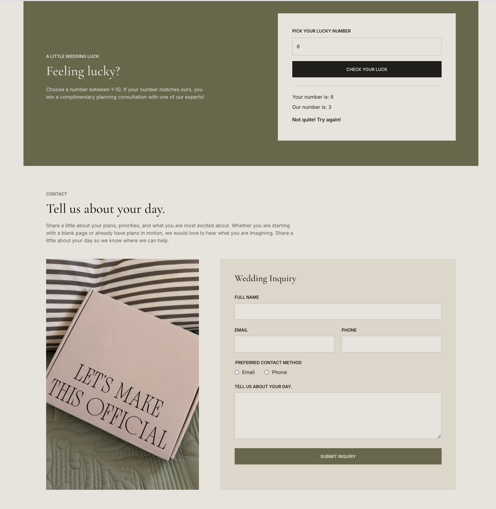

# The Aisle Studio — Wedding Planning Website

**GIT 417 Final Project | Front-End Web Development**  
**Focus:** Interactive JavaScript, service selection, theme switching, and form validation  
**Technologies:** HTML, CSS, JavaScript

**[View the Project Process on Behance](https://www.behance.net/gallery/256856183/The-Aisle-Studio)** · **[GitHub](https://github.com/bridgetlaporte/aisle-studio)**

*Homepage — original visual direction, typography, and photography.*

## Overview

I created The Aisle Studio, a single-page website for a fictional wedding planning company, as my final project for GIT 417. I wanted the site to feel like a realistic boutique studio while demonstrating interactive JavaScript features alongside its design.

## Objective

The goal was to create a professional, visually appealing website that introduced the company's services and gave visitors meaningful ways to interact with the page. I focused on pairing a clear layout with JavaScript features that supported engagement and functionality.

## Synopsis

The website was inspired by modern wedding planning websites that emphasize minimal layout, photography, and elegant designs. I wanted to create a sophisticated, realistic website with an approachable experience that reflected the personal nature of wedding planning while integrating features that felt natural and useful.

## Process

I designed and developed the site using HTML, CSS, and JavaScript. I established the visual direction, organized the page content, and incorporated my own photography. I then programmed interactive service selections, a light/dark mode toggle, a randomized Lucky Draw number-guessing game, and a contact form with regular-expression (regex) validation. Throughout development, I focused on making the interactions work within a cohesive design.

## Results

The completed single-page website includes service descriptions that change through user interaction, two display modes, a functioning number-guessing game, and a contact form that validates user information and displays a confirmation. I completed the project independently without a client budget. The form demonstrates front-end validation; it is not presented as a live back-end inquiry system.

The full project presentation is available on **[Behance](https://www.behance.net/gallery/256856183/The-Aisle-Studio)**.

## Project Photos

These screenshots highlight two of the JavaScript interactions built into the website.

<table>
  <tr>
    <td width="50%" align="center" valign="top">
      
       
      <em>Service selector — the displayed package information updates based on the visitor's choice.</em>
    </td>
    <td width="50%" align="center" valign="top">
      
       
      <em>Lucky Draw — a randomized JavaScript number-guessing game.</em>
    </td>
  </tr>
</table>

---

[← Back to my GitHub profile](../README.md)
