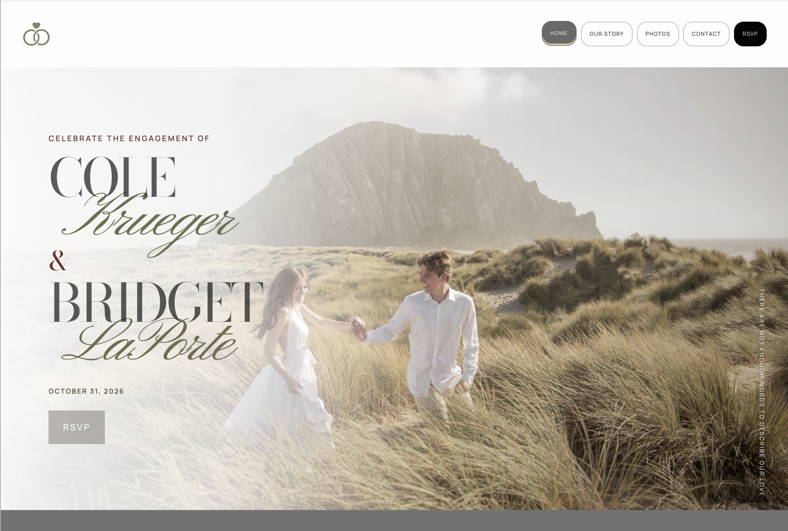
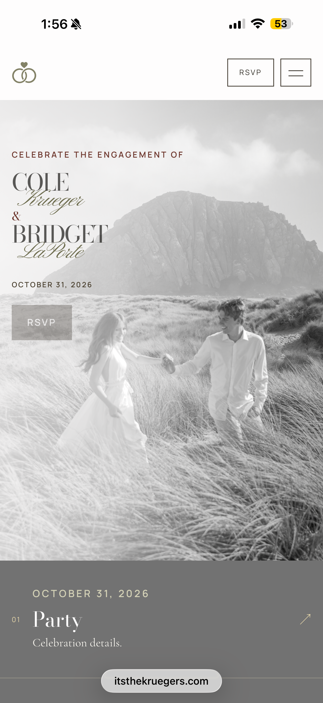
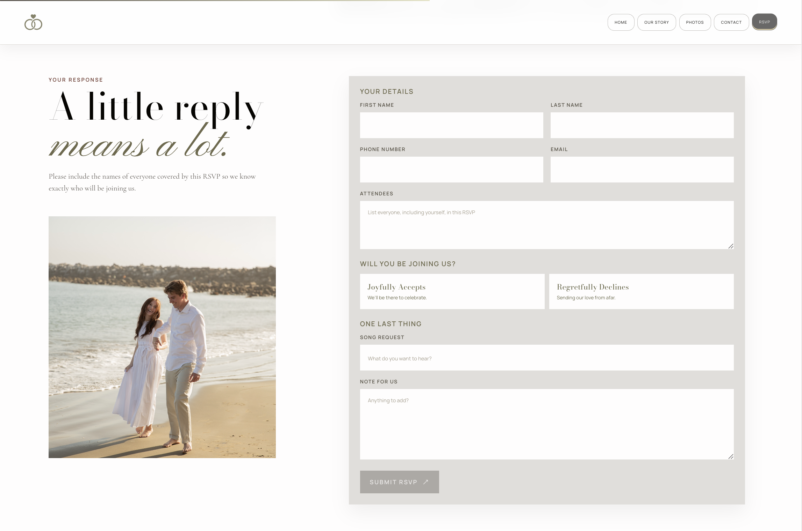

#  The Kruegers Engagement Party Website

**Independent web development project | October 2026**  
**Focus:** Mobile-first design, responsive layouts, interactive galleries, and RSVP integration via back-end  
**Technologies:** HTML, CSS, JavaScript, Google Apps Script, Google Sheets

**[Visit the Live Website](https://itsthekruegers.com/)** · **[GitHub](https://github.com/laportebridget/itsthekruegers)**

*Desktop homepage: custom typography, photography, navigation, and event information.*

## Overview

I designed and developed a multi-page website for our engagement party to bring event information, photographs, and guest RSVPs into one place. The site combines personal storytelling with responsive design and functional event planning features.

## Objective

I wanted to create a central website where engagement party guests could access the event details, see photos, and submit their RSVPs. The goal was to replace paper invitations and digital messages with a single, accessible digital experience that worked across various devices for different users.

## Synopsis

Inspired by modern wedding websites, I combined personal style with a functional web application. I focused on elegant typography, creative use of photography, a strong color palette, and intuitive navigation to create a website that felt personal while staying practical for guests. The website follows a mobile-first system that functions on all screen sizes.
 
## Process

I designed and developed a multi-page website using HTML, CSS, and JavaScript. I created responsive layouts, navigation, interactive photo galleries, and contact and RSVP forms that connected to outside applications. To do this, I used Google Apps Script and Google Sheets to collect responses.

## Results

I created the website for our October 31, 2026 engagement party. It provided a central place for event information, photographs, and guest RSVPs. This was an independent project without a formal client budget. The finished site is available at **[itsthekruegers.com](https://itsthekruegers.com/)**.

## Project Photos

The following screenshots show how the desktop design adapts to mobile and how guests interact with the RSVP form.

<table>
  <tr>
    <td width="36%" align="center" valign="top">
      
       
      <em>Mobile homepage — responsive layout and navigation</em>
    </td>
    <td width="64%" align="center" valign="top">
      
       
      <em>RSVP form — guest-facing interface connected to Google Apps Script and Sheets</em>
    </td>
  </tr>
</table>

---

[← Back to my GitHub profile](../README.md)
