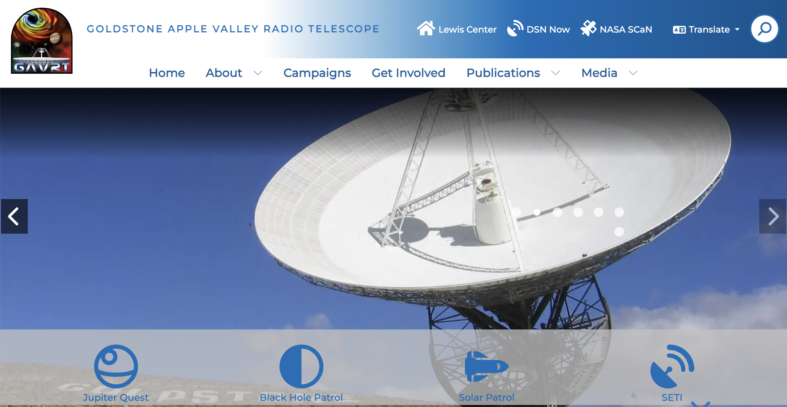
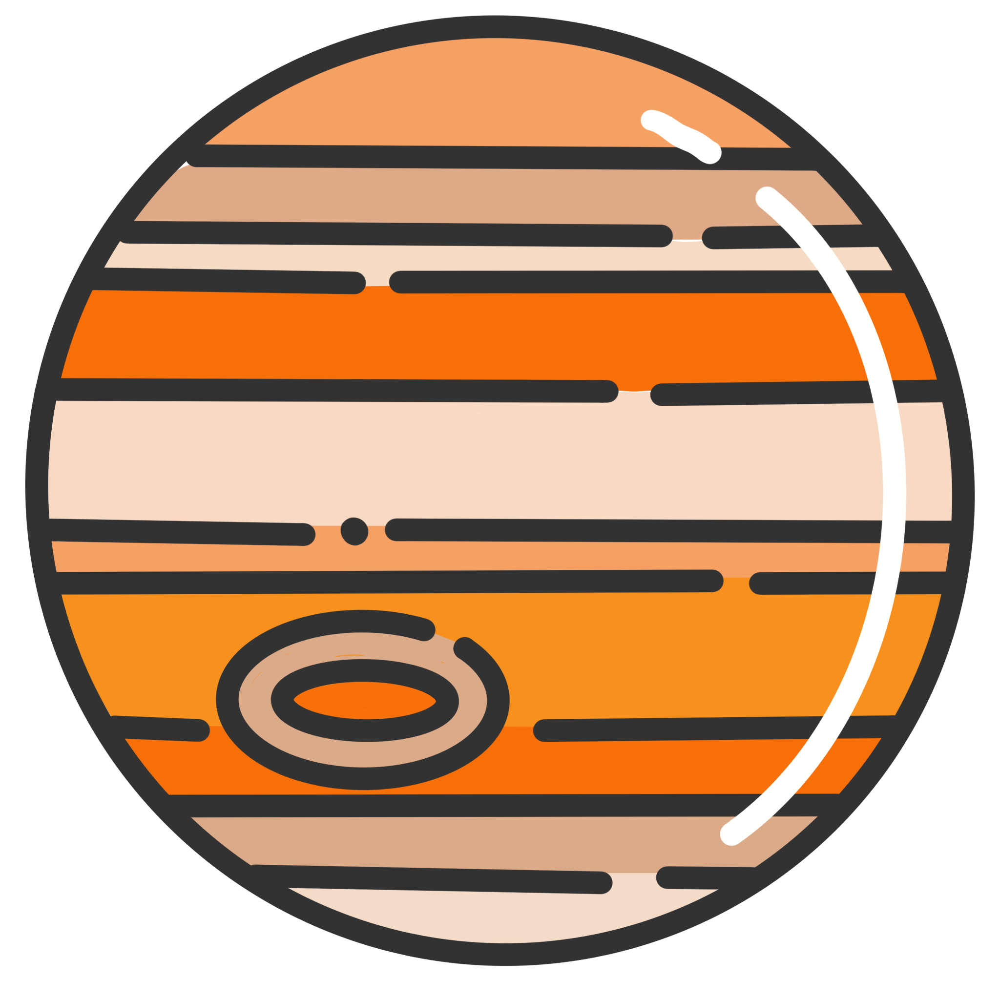
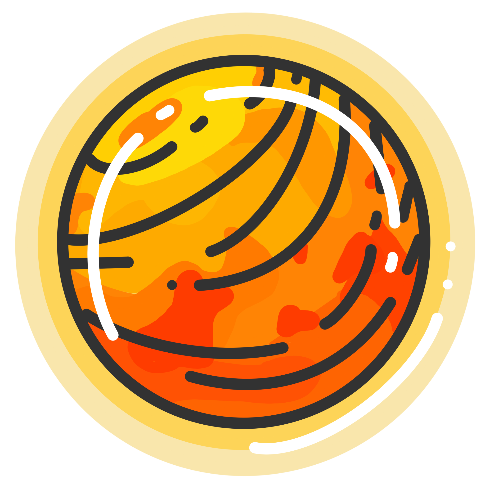
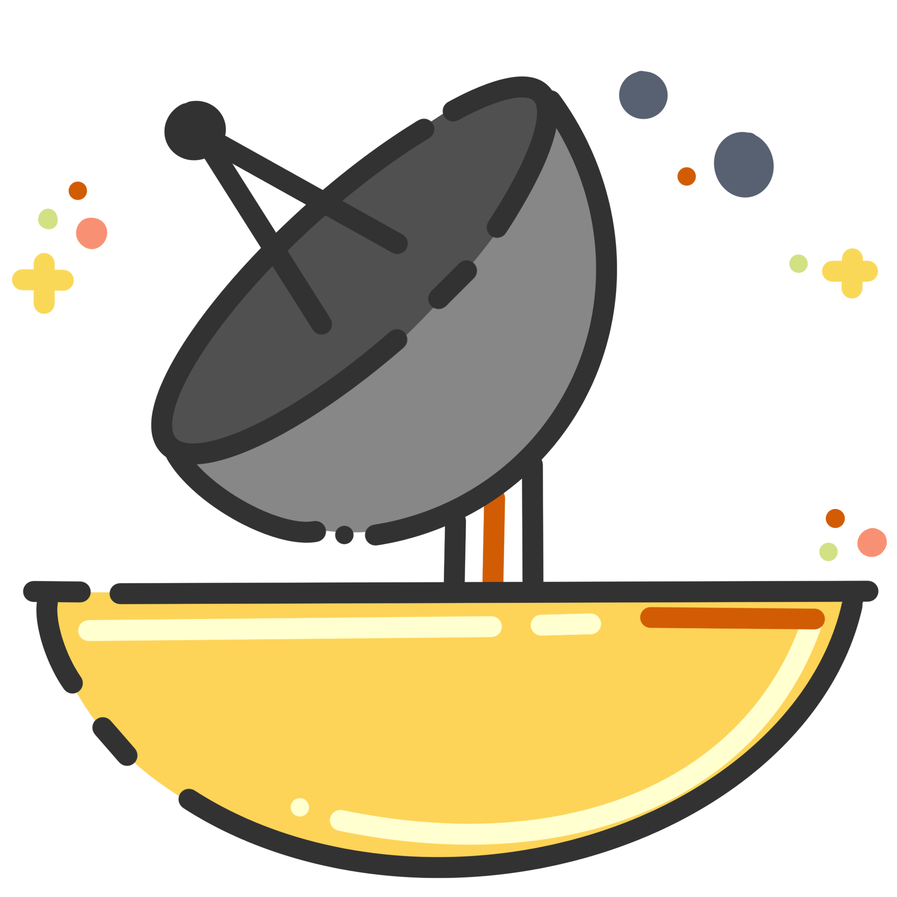

# NASA — GAVRT Website Modernization & Accessibility

**NASA Glenn Research Center · Digital Communications & Web Development Internship**  
**Focus:** Website modernization, accessibility, scientific research translation, updated campaigns,communication, and original campaign icon design

*GAVRT public website homepage. The live site may have changed since my internship.*

**[Visit the GAVRT Website](https://gavrt.lewiscenter.org/)**

## Overview

During my internship at NASA's Glenn Research Center, I worked on the broader GAVRT website, with a particular focus on four research campaigns: Jupiter Quest, Black Hole Patrol, Solar Patrol, and SETI. I helped make technical research more accessible to students, educators, and the general public while following the program's existing visual identity and communication goals.

## Featured Research Campaigns

I reorganized and revised information for these four campaigns and created a custom icon for each. Select an icon or campaign name to explore its public webpage.

<table>
  <tr>
    <td width="50%" align="center" valign="top">
      <a href="https://gavrt.lewiscenter.org/Campaigns/Jupiter-Quest/">
         
        <strong>Jupiter Quest</strong>
      </a>
    </td>
    <td width="50%" align="center" valign="top">
      <a href="https://gavrt.lewiscenter.org/Campaigns/Black-Hole-Patrol/">
         
        <strong>Black Hole Patrol</strong>
      </a>
    </td>
  </tr>
  <tr>
    <td width="50%" align="center" valign="top">
      <a href="https://gavrt.lewiscenter.org/Campaigns/Solar-Patrol/">
         
        <strong>Solar Patrol</strong>
      </a>
    </td>
    <td width="50%" align="center" valign="top">
      <a href="https://gavrt.lewiscenter.org/Campaigns/SETI/">
         
        <strong>SETI</strong>
      </a>
    </td>
  </tr>
</table>

## Objective

During my time working at NASA's Glenn Research Center, I updated content across the GAVRT website, including four research campaigns. The goal was to improve accessibility, modernize outdated content, and make complex scientific research more understandable for students, educators, and the public.

## Synopsis

This project followed the existing visual styles and goals of NASA, JPL, and GAVRT. I reorganized information and research on decades of scientific research across four campaigns, rewrote technical explanations, improved web structure, all while working alongside scientists to bridge the knowledge gap between scientists and everyday individuals.

## Process

Reviewed scientific material spanning approximately 30 years of research, worked with NASA and JPL scientists to ensure accuracy. Reorganized information across the four research campaigns, revised technical explanations, designed and created custom icons for each campaign, and developed a functioning, well-designed website.

## Results

I completed the final draft in week nine of the eleven-week internship, ahead of the original deadline. The work was reviewed by stakeholders and presented to NASA leadership. I did not have direct budget oversight. The public GAVRT webpages are available through the [official GAVRT website](https://gavrt.lewiscenter.org/).

*The website is operated by the GAVRT program. This case study describes my contributions during my internship; it does not claim ownership of the entire website. Internal source code and unpublished project materials are not reproduced here.*

---

[← Back to my GitHub profile](../README.md)
